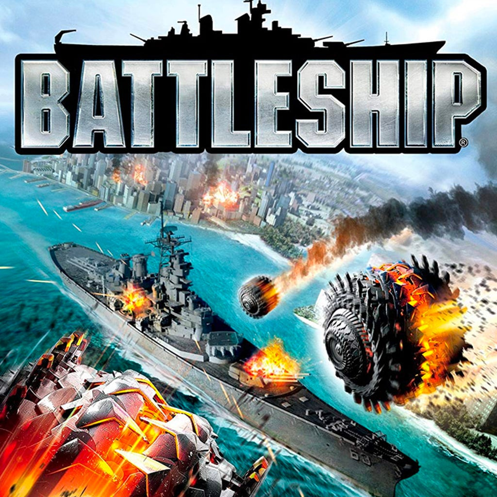
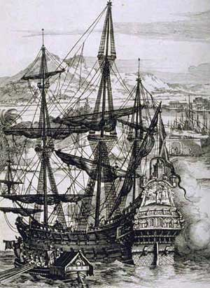
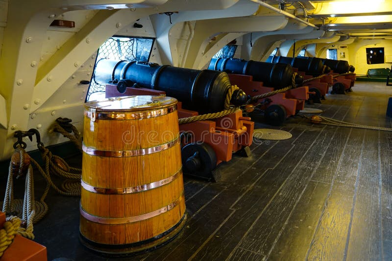
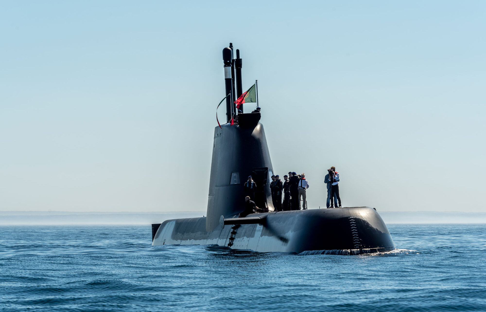

# Battleship

    </image>

-----------

## Grupo Adamastor
| Curso |    Nome       | Número |
| ---   | ---           | ---    |
| LEI   |José Cardoso   | 124708 |
| LEI   |João Rebelo    | 131056 |
| LEI   | Daniel Santos | 131591 |
| LEI   | Pedro Victor  | 129823 |

-----------

## Regras
> Cada jogador começa por construir duas grelhas quadriculadas iguais, com dimensões de **10×10**. Uma grelha representa o seu próprio mar e a outra representa o mar do adversário.

> De seguida, cada jogador deverá posicionar os seus navios na sua grelha (ver [Tipos de Navios](#tipos-de-navios)), respeitando a regra de que os navios **não podem tocar entre si**, nem horizontal, vertical ou diagonalmente.

> As coordenadas são representadas pelo par **(x, y)**, onde **x, y ∈ [0, 9]**.

-----------

## Regras Adicionais
Depois de os dois jogadores posicionarem as suas frotas, o jogo decorre por turnos.

Para cada turno, o jogador efetua uma rajada de três tiros, indicando as coordenadas **(x, y)** correspondentes às posições que este quer atacar no tabuleiro do oponente.

O oponente indica o resultado de cada tiro:
- **Água**: o tiro não atingiu nenhum navio.
- **Acerto**: o tiro atingiu um navio.
- **Afundado**: todas as posições ocupadas por este navio foram atingidas.

A partida se encerra quando um dos jogadores atinge todos os navios de seu adversário.

## Tipos de Navios

>Para esta versão do jogo Batalha Naval, os tipos de navios são inspirados na épocsa dos Descobrimentos. Cada jogador dispõe de uma frota de navios, com os seguintes tipos:

| Navio     | Dimensão  | #Navios   |
| --------- | --------- | --------- |
| Galeão    |   5       |   1       |
| Fragata   |   4       |   1       |
| Nau       |   3       |   2       |
| Caravela  |   2       |   3       |
| Barca     |   1       |   4       |

-----------

### Fotografias:

    </image>

    </image>

    </image>

-------------

#### Referências:

> Wikipedia contributors. (n.d.). Battleship (game). In *Wikipedia*. Retrieved September 18, 2026, from [https://en.wikipedia.org/wiki/Battleship_(game)](https://en.wikipedia.org/wiki/Battleship_\(game\))

>Colaboradores da Wikipédia. (s.d.). Galeão. Em *Wikipédia, a enciclopédia livre*. Consultado em 18 de setembro de 2026, em [https://pt.wikipedia.org/wiki/Galeão](https://pt.wikipedia.org/wiki/Gale%C3%A3o)

> Colaboradores da Wikipédia. (s.d.). Submarino. Em *Wikipédia, a enciclopédia livre*. Consultado em 18 de setembro de 2026, em [https://pt.wikipedia.org/wiki/Submarino](https://pt.wikipedia.org/wiki/Submarino)

---------

## Testes e integração contínua (Fichas 3/4)

Requer Java 17 ou posterior e Maven 3.9; validação local com Java 21.
`mvn --batch-mode clean verify` compila, executa JUnit Jupiter 6.0.0 e gera
cobertura JaCoCo 0.8.14 em `target/site/jacoco/index.html` (XML e CSV incluídos).
JUnit 6 segue o requisito inicial da Ficha 4; a referência posterior a JUnit 5
é tratada como referência à API Jupiter, utilizada por estes testes.

O workflow `.github/workflows/maven.yml` executa em cada push e pull request,
com Java 21 e relatórios como artifacts. Uma execução local bem sucedida não
prova que Actions passou: verificar a execução associada ao commit do PR.
Não há exclusões artificiais de classes para aumentar percentagens.
Os testes `KNOWN DEFECT` caracterizam defeitos existentes, não comportamento
correto; ver issue #22. Devem ser convertidos em regressão quando corrigidos.

Ver `reports/LEI-129823/README.md`, `CodeMetrics/README.md` e
`RefactoringOpportunities.md`. Os testes de apoio ao grupo não substituem a
reunião de distribuição individual. #14 (IA) e #15 (JSON) continuam pendentes.
